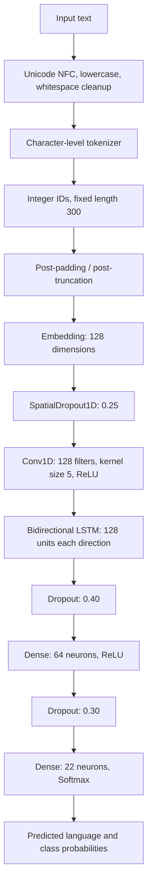

# Language Identification Using CNN + Bidirectional LSTM

## 1. Project overview

This project predicts the language of a text sample using a character-level deep-learning classifier built with TensorFlow/Keras. It uses the Kaggle Language Identification dataset and supports 22 language classes.

- **Dataset:** [Language Identification Dataset on Kaggle](https://www.kaggle.com/datasets/zarajamshaid/language-identification-datasst)
- **Notebook:** `Language_Identification_Refined.ipynb`
- **Framework:** TensorFlow / Keras
- **Model:** Character Embedding + 1D CNN + Bidirectional LSTM
- **Task:** Multiclass text classification
- **Runtime:** Google Colab
- **Random seed:** 42

The model combines a Convolutional Neural Network (CNN), which learns local character patterns, with a Bidirectional Long Short-Term Memory network (BiLSTM), which learns sequence context from both directions.

## 2. Problem statement

A multilingual communication platform needs to automatically identify the language of a given text sample. The system downloads labelled text samples, cleans and encodes the text, trains a neural network, evaluates it with classification metrics, displays a confusion matrix, and predicts the language of new text.

## 3. Dataset and language classes

The notebook loads the dataset with `kagglehub`:

```python
import kagglehub

dataset_path = kagglehub.dataset_download(
    "zarajamshaid/language-identification-datasst"
)
print("Dataset path:", dataset_path)
```

The notebook locates the CSV file and identifies the text and label columns. The dataset run included **22,000 original rows**, with columns `Text` and `language`.

The 22 supported classes in the notebook are:

Arabic, Chinese, Dutch, English, Estonian, French, Hindi, Indonesian, Japanese, Korean, Latin, Persian, Portugese, Pushto, Romanian, Russian, Spanish, Swedish, Tamil, Thai, Turkish, and Urdu.

The spelling `Portugese` is preserved because that is how the class is named in the dataset/notebook.

## 4. Preprocessing and filtering

The notebook uses conservative cleaning and records suspicious samples for review rather than silently changing their labels.

1. Check for missing text and language labels; remove rows missing either value.
2. Normalize text with Unicode NFC normalization.
3. Convert text to lowercase and trim leading/trailing whitespace.
4. Replace repeated whitespace with a single space.
5. Remove empty text and empty labels.
6. Flag normalized text that occurs with conflicting labels.
7. For selected languages, flag long texts that contain no character from the expected writing system. These are review heuristics, not a guarantee that a label is incorrect.
8. Quarantine flagged rows for this run.
9. Remove repeated normalized text-label pairs, retaining the first occurrence.
10. Split the cleaned data before generating training-only fragments.

### Observed data audit

The uploaded notebook's recorded run reported:

| Audit item | Result |
|---|---:|
| Original rows | 22,000 |
| Missing values in `Text` / `language` | 0 / 0 |
| Rows flagged for writing-system mismatch | 110 |
| Conflicting duplicate-label texts | 0 |
| Repeated text-label pairs removed | 140 |
| Rows retained for modelling | 21,749 |

Writing-system rules cover Arabic, Chinese, Hindi, Japanese, Korean, Persian, Pushto, Russian, Tamil, Thai, and Urdu. This filter cannot reliably distinguish languages that share a script, such as English and French or Arabic, Persian, and Urdu.

## 5. Tokenization, scaling, and padded sequences

### Tokenization method

The model uses **character-level tokenization**, rather than word-level tokenization. This is useful for multilingual text because the classifier can learn patterns from different writing systems without needing a separate word vocabulary for each language.

```python
Tokenizer(
    char_level=True,
    lower=True,
    filters="",
    oov_token="<OOV>"
)
```

`filters=""` keeps punctuation and other characters that Keras might otherwise remove by default. Text normalization is handled separately.

The tokenizer is fitted on the training data and training-derived fragments only, not on the validation or test data.

### Numerical representation

Each character is converted into an integer ID. Each sequence is then padded or truncated to 300 character positions.

| Parameter | Value |
|---|---:|
| Tokenization | Character-level |
| Character vocabulary size in recorded run | 6,661 |
| Maximum sequence length | 300 |
| Padding | Post-padding |
| Truncation | Post-truncation |
| Embedding dimension | 128 |
| Number of output classes | 22 |

The resulting training tensor in the recorded run had shape `(46967, 300)`. The validation tensor had shape `(1740, 300)`, and the held-out test tensor had shape `(4350, 300)`.

### Is scaling required?

**No numeric feature scaling such as Min-Max scaling or StandardScaler is used.** Text is converted into integer character IDs, then the Embedding layer learns a 128-dimensional representation for each character. These embedding values are learned during training, so conventional scaling of the raw text is not applicable.

## 6. Model selection and architecture

**Selected model: 1D CNN + Bidirectional LSTM (BiLSTM).**

The CNN identifies short local patterns across a window of five characters. The BiLSTM then learns context in both the forward and backward directions. Dense layers combine these learned features and the Softmax output layer returns a score for each of the 22 languages.

### Architecture diagram



### Layer configuration

| Layer | Configuration | Role |
|---|---|---|
| Input | 300 integer character IDs | Receives the encoded text |
| Embedding | 128 dimensions | Learns a vector representation for each character ID |
| SpatialDropout1D | Rate 0.25 | Regularizes embedding features |
| Conv1D | 128 filters, kernel size 5, ReLU, `same` padding | Learns local character patterns |
| Bidirectional LSTM | 128 units forward + 128 units backward | Learns context from both directions |
| Dropout | Rate 0.40 | Reduces overfitting |
| Dense hidden layer | 64 neurons, ReLU | Combines extracted features |
| Dropout | Rate 0.30 | Further regularization |
| Output Dense | 22 neurons, Softmax | Gives a score/probability for each language class |

### How many input nodes, hidden layers, and filters?

These terms need to be distinguished because the model starts with token IDs, not a one-hot vector of input neurons.

- **Input length:** 300 character positions per text sample.
- **Input representation:** one integer ID at each position. Vocabulary size in the recorded run is 6,661, including reserved IDs.
- **Embedding output shape:** `(batch_size, 300, 128)`.
- **CNN filters:** 128 filters; each filter spans 5 character positions.
- **LSTM hidden units:** 128 in the forward LSTM and 128 in the backward LSTM. The two final representations are concatenated, producing 256 features.
- **Dense hidden layer:** 64 neurons.
- **Output nodes:** 22, one per language class.

The architecture has one Conv1D layer, one Bidirectional LSTM layer (containing a forward and a backward LSTM), one hidden Dense layer, and one output Dense layer. Dropout layers are regularizers and are not Dense hidden layers.

## 7. Algorithm and working principle

### Training algorithm

1. **Load and clean:** Read labelled text samples and apply Unicode-aware normalization and auditing.
2. **Encode labels:** Convert each language label to an integer class ID using `LabelEncoder`.
3. **Split the data:** Create stratified training, validation, and test sets. Keep the test set separate until final evaluation.
4. **Training-only augmentation:** Create short text fragments from training samples to teach the model to handle shorter inputs. The validation and test sets are not augmented.
5. **Tokenize:** Fit a character tokenizer using training text only and map characters to integer IDs.
6. **Pad/truncate:** Make every sequence 300 positions long.
7. **Forward pass:** The Embedding layer creates vectors; the CNN learns local patterns; the BiLSTM learns bidirectional context; Dense layers produce class scores.
8. **Calculate loss:** Sparse categorical cross-entropy compares the predicted class distribution with the correct integer label.
9. **Backpropagation:** Gradients of the loss are calculated through the network.
10. **Update weights:** Adam adjusts the model's trainable weights to reduce the loss.
11. **Validate:** After each epoch, measure validation loss and accuracy.
12. **Control training:** Early stopping monitors validation loss and restores the best weights. ReduceLROnPlateau reduces the learning rate when validation loss stops improving.
13. **Test once:** Evaluate the final selected model on the held-out test set and report accuracy, precision, recall, F1-score, and the confusion matrix.

### How the model learns

During training, the network starts with learned parameters that are not yet suited to language identification. It processes batches of padded character sequences and produces a probability distribution over the 22 classes. The loss measures the difference between the predicted distribution and the true language label. Backpropagation calculates how each trainable parameter contributed to that error, and Adam updates the parameters. Repeating this process over epochs helps the model learn character patterns and language-specific sequence structure.

### Training method and hyperparameters

| Setting | Value |
|---|---|
| Optimizer / training method | Adam with mini-batch gradient-based backpropagation |
| Loss function | Sparse categorical cross-entropy |
| Metric during training | Accuracy |
| Batch size | 64 |
| Maximum epochs | 10 |
| Early stopping | Monitor `val_loss`, patience 2, restore best weights |
| Learning-rate scheduler | ReduceLROnPlateau, factor 0.5, patience 1, minimum LR `1e-5` |
| Random seed | 42 |

### Data split

The notebook first reserves 20% of cleaned examples for testing. It then reserves 10% of the remaining 80% for validation. This gives approximately 72% training, 8% validation, and 20% test source examples.

| Split | Recorded examples |
|---|---:|
| Training source examples | 15,659 |
| Training-only short fragments generated | 31,308 |
| Combined training examples | 46,967 |
| Validation examples | 1,740 |
| Held-out test examples | 4,350 |

The 31,308 short fragments are generated only from the training partition, then mixed with the original training samples and shuffled. Validation and test examples remain untouched by augmentation.

## 8. Evaluation results

The notebook's recorded run reports the following metrics on the held-out test set:

| Metric | Result |
|---|---:|
| Test loss | 0.0738 |
| **Accuracy** | **98.30%** |
| Macro precision | 98.40% |
| Macro recall | 98.28% |
| Macro F1-score | 98.30% |
| Weighted precision | 98.39% |
| Weighted recall | 98.30% |
| Weighted F1-score | 98.30% |

- **Accuracy:** Percentage of all test samples assigned the correct language.
- **Precision:** Of the samples predicted as a given language, the proportion that truly belongs to that language.
- **Recall:** Of all samples belonging to a language, the proportion correctly identified.
- **F1-score:** Harmonic mean of precision and recall.
- **Macro average:** Gives every language class equal weight.
- **Weighted average:** Weights each class by its number of test samples.

These are results from the recorded notebook run. Re-running with a different dataset version, runtime, or training result may produce slightly different metrics.

### Confusion matrix

The notebook plots a 22 × 22 confusion matrix using the held-out test predictions.

- Rows represent the actual language.
- Columns represent the predicted language.
- Diagonal cells are correct predictions.
- Off-diagonal cells show misclassifications.

The plot is generated in the evaluation cell with Seaborn. The notebook also prints a per-language classification report and diagnostics grouped by text length.

### Short-text check

The notebook evaluates 220 curated short-text examples, 10 for each language. In the recorded run, **197 out of 220 were correct (89.55%)**. This is a separate smoke test and should not be confused with the held-out test accuracy of 98.30%. Short snippets are harder because they contain less evidence for distinguishing languages that share a writing system.

## 9. How prediction works

For a new text sample, the prediction function performs the same normalization, character tokenization, and padding used during training. It passes the resulting sequence to the trained network. Softmax produces scores for the 22 known languages; the class with the highest score is selected as the predicted language.

The function also prints the top three candidate languages and the top score as a confidence percentage. It warns when the input is shorter than 50 characters or when the top score is below 65%. Softmax confidence is not a guarantee that a prediction is correct.

### Example: predict five unseen samples

Run the following after training cells have completed. The predictions and confidence scores are generated by the model when you run the cell; they are not hard-coded.

```python
unseen_samples = [
    "வணக்கம்! இன்று எப்படி இருக்கிறீர்கள்?",
    "Hello, how are you today?",
    "Bonjour, comment allez-vous ?",
    "今日はいい天気ですね。",
    "مرحبا، كيف حالك اليوم؟",
]

for sample in unseen_samples:
    predict_language(sample)
```

To enter your own text interactively, run the final notebook cell and type a sentence. Enter `exit` to stop the loop.

## 10. Run the project in Google Colab

1. Open [Google Colab](https://colab.research.google.com/).
2. Upload `Language_Identification_Refined.ipynb`.
3. Select a Python runtime. GPU acceleration can reduce training time, but is not mandatory.
4. Run the notebook cells in order.
5. Allow `kagglehub` to download the dataset. If Kaggle authentication is requested in your environment, configure the required Kaggle credentials securely in Colab. Do not commit API tokens to GitHub.
6. Check the printed audit summary and class count.
7. Review the training curves, held-out test metrics, confusion matrix, and prediction outputs.
8. Run the interactive prediction cell only when you want to enter text manually.

### Main libraries

- TensorFlow / Keras
- `kagglehub`
- `pandas` and `numpy`
- `scikit-learn`
- `matplotlib` and `seaborn`

The notebook installs `kagglehub` and imports the other libraries. If a runtime reports a missing package, install that package in a separate Colab cell and rerun the imports.

## 11. Saved model files

After the saving cell completes, the notebook writes these files in the Colab runtime:

- `/content/language_identification_cnn_bilstm.keras` - trained model
- `/content/language_identification_tokenizer.json` - character tokenizer configuration
- `/content/language_identification_classes.json` - class names and sequence metadata
- `/content/language_identification_test_metrics.json` - test metrics
- `/content/language_identification_audit_flags.csv` - records flagged during the data audit

Download needed files from the Colab Files panel before the runtime is deleted.

## 12. Limitations

- The model can predict only one of its 22 trained language classes; it does not have an “unknown language” output.
- Short inputs, transliteration, code-switching, misspellings, names, and mixed-language text can reduce accuracy.
- Languages that use the same writing system can be difficult to distinguish from short samples.
- The writing-system audit is a heuristic and does not prove a label is incorrect.
- Softmax scores are not calibrated probabilities.
- High test accuracy does not guarantee the same performance on every real-world source or domain.

## 13. References

- Dataset: [Language Identification Dataset on Kaggle](https://www.kaggle.com/datasets/zarajamshaid/language-identification-datasst)
- TensorFlow: [https://www.tensorflow.org/](https://www.tensorflow.org/)
- Keras: [https://keras.io/](https://keras.io/)
- scikit-learn model evaluation: [https://scikit-learn.org/stable/modules/model_evaluation.html](https://scikit-learn.org/stable/modules/model_evaluation.html)
